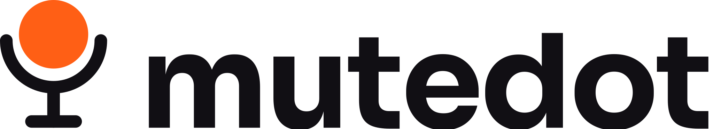
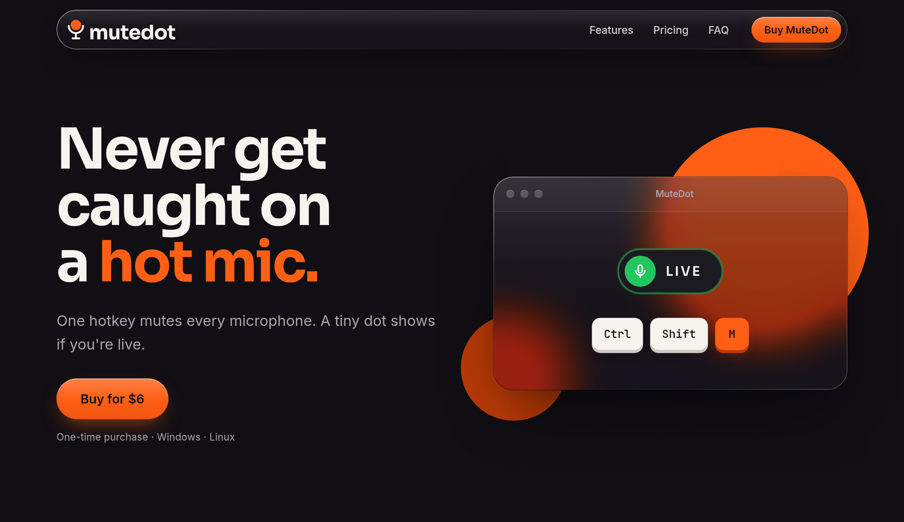
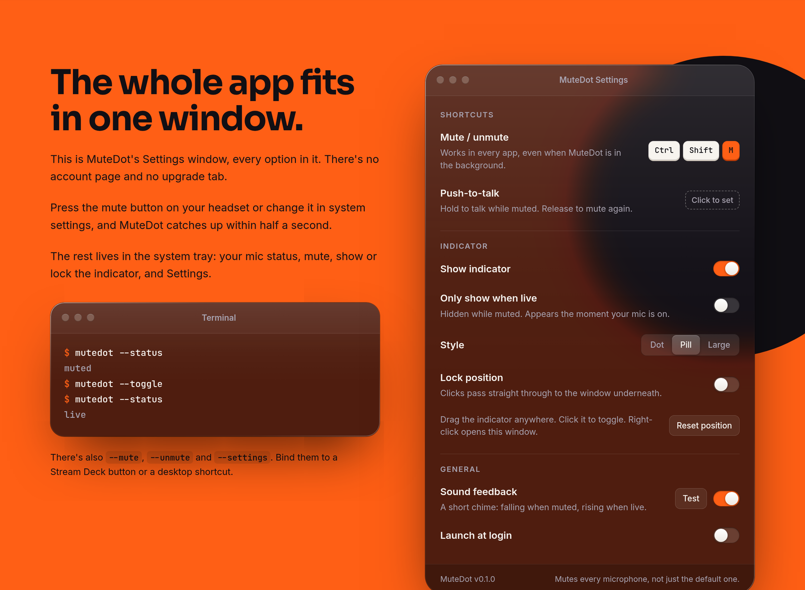

<picture>
  <source media="(prefers-color-scheme: dark)" srcset="logo/svg/mutedot-lockup-color-on-dark.svg">
  
</picture>

### The marketing site for MuteDot. Plain HTML and CSS. No JavaScript, no build step.

 

 

 

## ✦ Pages

| Path | What it is |
|---|---|
| `index.html` | Landing page. The hero demo is pure CSS. |
| `windows/` · `linux/` | Setup guides: how to mute your mic with a shortcut on each OS. They exist mostly for search. |
| `privacy/` · `terms/` · `refunds/` | Legal pages |
| `buy/index.html` | Short link (`mutedot.xyz/buy/`) that redirects to checkout |
| `404.html` | Not-found page |
| `css/site.css` | Every style on the site |
| `fonts/` | Inter, Sora and JetBrains Mono (latin subset), served from the site so nothing loads from Google |
| `robots.txt` · `sitemap.xml` | For search engines. Add new pages to the sitemap. |
| `logo/svg/` | Lockups from the brand kit, unchanged |
| `favicon.*` · `apple-touch-icon.png` · `icon-*.png` · `og-image.png` · `site.webmanifest` | Icons and social card |

 

## ✦ Design

The site uses the brand kit's bold blocks of **Ink**, **Paper** and **Hot Orange**, plus macOS-style liquid glass:
a floating capsule nav, and frosted windows with lit rims sitting over solid orange dots taken from the logo.

The Settings window and the terminal on the page copy the real app. They use the same rows,
hints and defaults as the app's Settings window, and the same CLI flags.
**If the app's settings change, update this section too.**

<b>Brand tokens</b>

 

| Token | Hex | Use |
|---|---|---|
| Hot Orange | `#FF5F15` | CTAs, highlights, the dot. Text on orange is always Ink. |
| Ink | `#110F14` | Text, dark sections |
| Paper | `#F7F4EF` | Light background |
| Night | `#1C1A21` | Surfaces on dark |
| Ember | `#B93A06` | Orange for small text and links on light |
| Slate | `#5E5966` | Secondary text on light |
| Mist | `#A8A3B0` | Secondary text on dark |
| Live / Muted | `#22C55E` / `#EF4444` | **The indicator only** |

Type: **Sora** for headings, **Inter** for body text, **JetBrains Mono** for keys and code.

 

## ✦ Before you launch

No placeholders are left.

| Setting | Value | Where |
|---|---|---|
| Domain | **mutedot.xyz** | `CNAME`, plus the canonical and Open Graph tags |
| Checkout | [Lemon Squeezy](https://mutedot.lemonsqueezy.com/checkout/buy/5e4ba5b7-3cd9-493f-b8fe-c976cc8fae09) | Every Buy button, and the `buy/` redirect |

If the checkout link changes, find and replace it across the folder. It's also in the structured data in `index.html`.

After the site is live, add `mutedot.xyz` to [Google Search Console](https://search.google.com/search-console) and submit `https://mutedot.xyz/sitemap.xml`.

> [!WARNING]
> The Product Hunt images in the brand kit still say "macOS · Windows · Linux". Re-export them without macOS before posting.

> [!NOTE]
> The legal pages are plain-language starting points, not legal advice.

 

## ✦ Deploy

Publish the repo root as the site. No build command is needed.

| Host | Settings |
|---|---|
| **Netlify / Cloudflare Pages** | Publish directory `/` (repo root), no build command |
| **Vercel** | Framework preset "Other", output directory `.` |
| **GitHub Pages** | Serve from the `main` branch root. `CNAME` already sets the custom domain. |

The favicon and 404 paths are root-relative (`/favicon.ico`), so a `username.github.io/repo/` project URL would break them. Use a custom domain.

 

© 2026 Aubergine-UX and 523co. All rights reserved.

